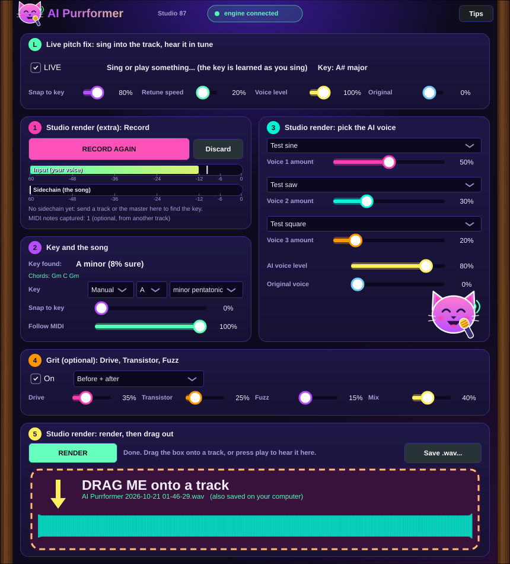

# AI Purrformer

Free, open source AI singing voice tool for Linux. Part of the cat plugin suite by Studio 87.

**Goal:** sing badly, get a much better voice back: on time, on key, in tune with the song. Bonus: a lyric notepad and helper.

**Status:** early build (v0.1). The pipeline works end to end with a test voice; the real AI voice is not tested yet. See [Use it in your DAW](docs/USE-IN-YOUR-DAW.md).

## How it works

**Live:** put it on your mic track and it pulls your singing onto the key in real time. **Studio render (extra):** record a take and re-sing it in an AI voice. The plugin (an effect with audio in, a sidechain and MIDI in) listens while your DAW plays, finds the key of the song, and re-sings your take in an AI voice, on key and on time. Then you **drag the result onto any track**.

1. Put **AI Purrformer** on your vocal track and press **Record**, then play your DAW and sing.
2. Optional: send the master to the sidechain (it finds the key and chords), or MIDI from another track (it follows those notes).
3. Pick a voice, press **Render**.
4. Drag the pink box onto a track (a .wav is saved too).

Two plugins come in the install: **AI Purrformer** (effect, your voice in) and **AI Purrformer Sing** (instrument, MIDI and lyrics in, works in every host). Everything runs locally on your computer. Live mode is a real time pitch fix of your own voice; the AI voice is a record-then-render step.

Step by step with pictures: [Use it in your DAW](docs/USE-IN-YOUR-DAW.md).

## Target setup

- OS: Bazzite KDE (immutable Fedora), no dual boot
- DAWs: Bitwig, Studio One
- GPU: AMD RX 9070 XT (ROCm, not CUDA)
- Engine runs in an Ubuntu container (Distrobox); plugin talks to it over localhost

## Layout

- `plugin/` JUCE plugin (AGPL-3.0)
- `engine/` Python local server
- `lyrics/` lyric notepad and helper
- `flatpak/` Flathub packaging (later)
- `docs/` research, architecture, install notes, roadmap

## Docs

- [Use it in your DAW (start here)](docs/USE-IN-YOUR-DAW.md)
- [Engine research](docs/ENGINES.md)
- [Architecture](docs/ARCHITECTURE.md)
- [Install on Bazzite](docs/INSTALL-BAZZITE.md)
- [Voices and mixing](docs/VOICES.md)
- [Where the melody comes from](docs/MELODY-SOURCES.md)
- [FX, inferred accompaniment, lyric AI](docs/FX-AND-LYRICS.md)
- [Inspiration and borrowable ideas](docs/INSPIRATION.md)
- [Roadmap](docs/ROADMAP.md)

## License

Code: AGPL-3.0 (see `LICENSE`). Voice models and weights have their own terms; see `docs/ENGINES.md`. Only train and convert with voices you have the rights to use.

## Support

  

☕ Free and open source, made by one person. If it helps your music, a coffee on [Ko-fi](https://ko-fi.com/studio87) keeps it coming. 💜

**Routing per DAW (sidechain, MIDI, result):** [docs/DAW-GUIDES.md](docs/DAW-GUIDES.md)
