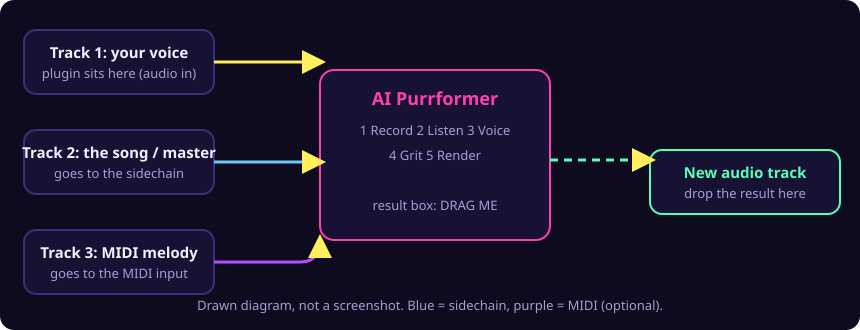

# Routing in your DAW: sidechain, MIDI, result

The plugin picture of each step is in [USE-IN-YOUR-DAW.md](USE-IN-YOUR-DAW.md). This page is only about the routing in the host.

**Honest status.** The steps below come from the makers' own help pages, read on 2026-10-19. We have **not** yet tested the plugin in these hosts ourselves, and we have no host screenshots yet (the pictures are the real plugin plus a drawn diagram). If a step is different in your version, please open an issue with a screenshot and we will fix this page.

## Ableton Live
- **Sidechain.** Put *AI Purrformer* on the track with your voice. In Live's plug-in window turn on **Sidechain**, then pick the song track in the **Audio From** dropdown. This is Live 10.1 and later ([Ableton help](https://help.ableton.com/hc/en-us/articles/209775325-Sidechaining-a-3rd-party-plug-in)). The plugin must expose its sidechain input: it does, but the input is off until you enable it in the host.
- **MIDI melody (optional).** Not verified for Live 12. An old Ableton forum thread (Live 8 era) says a MIDI track can send to an audio track that holds a plug-in which accepts MIDI: set the MIDI track's *MIDI To* to that track. Try it; if it does not work, use *Open .mid...* in the instrument version, or leave MIDI out. The key is found from the sidechain anyway.
- **Result.** Press *Render*, then drag the pink box onto an empty audio track.

## Bitwig Studio
- **Sidechain.** Put the plugin on the voice track. Open the sidechain selector with the sidechain icon at the top of the plugin and pick the song track from the dropdown (before or after its fader). Only shown for plug-ins that have a sidechain input ([Bitwig tutorial](https://www.bitwig.com/learnings/sidechaining-tutorial-49/)).
- **MIDI melody (optional).** A forum post lists Bitwig (and Reaper) as hosts that pass MIDI between plug-ins in one chain ([JUCE forum](https://forum.juce.com/t/vst3-midi-audio/62624)). Not tested by us.
- **Result.** Drag the pink box onto an audio track.

## Studio One
- **Sidechain.** Put the plugin on the voice track, press the **sidechain routing button** at the top of the plugin window, then enable a **Send** on the song track as the source ([Sonible guide](https://www.sonible.com/blog/sidechain-routing-daw/), written for Studio One 6; not checked for 7).
- **MIDI melody (optional).** The same forum post says Studio One needs manual MIDI routing. Not tested by us.
- **Result.** Drag the pink box onto an audio track.

## No sidechain? No problem
Leave the sidechain off. The plugin then reads the key from your recording, or you set the key by hand (*Key: Manual*, pick the note and the scale).

## Why the sidechain stays off until you turn it on
Hosts only connect an optional input when you ask for it. The plugin works without it.
