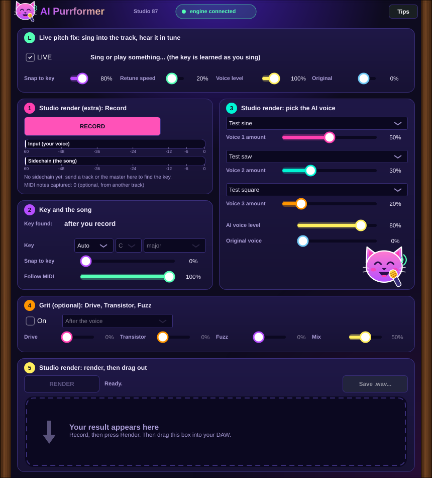
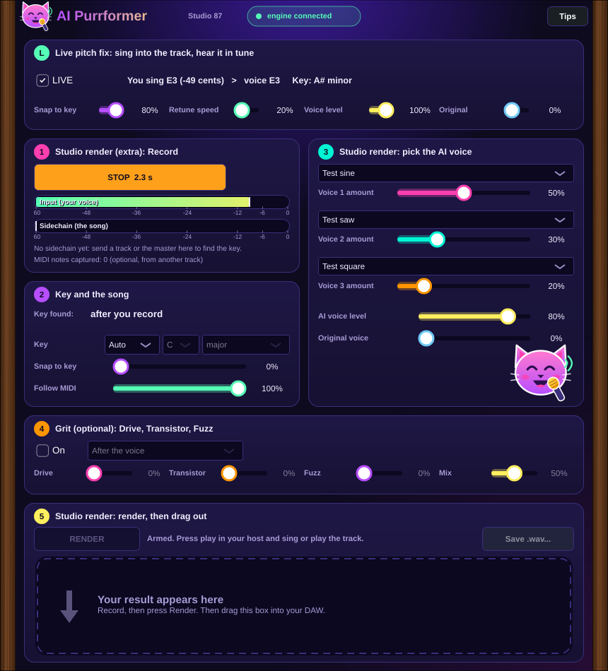
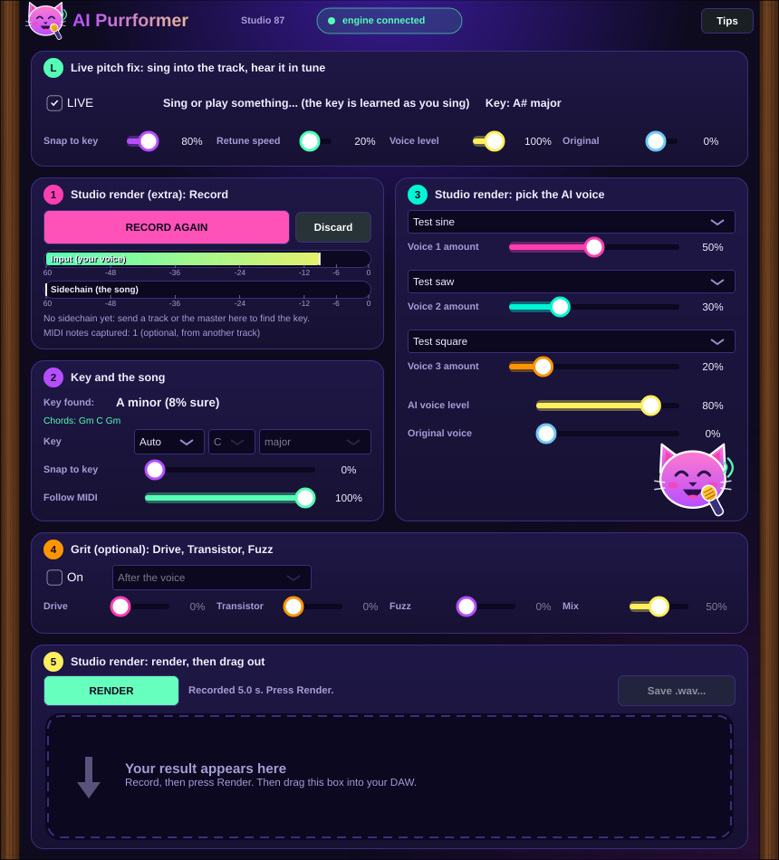

# Use AI Purrformer in your DAW

AI Purrformer is an **effect plugin**. You sing (or play) on a track, the plugin listens while your DAW plays, then it sings the result back in an AI voice. You drag the result onto any track.

There are two plugins in one install:

| Plugin | Type | What it does |
|---|---|---|
| **AI Purrformer** | Effect (audio in, sidechain in, MIDI in) | Your recorded voice becomes the AI voice. This guide. |
| **AI Purrformer Sing** | Instrument | MIDI notes and lyrics in, AI voice out. Works in every host, no recording needed. |

Everything runs on your computer. No account, no cloud.

## Live mode (the main thing)

Put the plugin on a track with your mic. Leave **LIVE** on. You sing, and you hear your voice pulled onto the key as you sing. Nothing to record.

- **Snap to key**: how hard notes are pulled onto the scale. **Retune speed**: left is instant and robotic, right is slow and natural.
- The key is learned from what you sing. You can set it yourself (*Key: Manual*, note, scale) in card 2.
- Send MIDI to the plugin and the voice sings those notes instead (**Follow MIDI**).
- **Grit** works live too. **Original** lets you hear your untouched mic next to the fixed voice.
- Live mode fixes the pitch of your own voice. It is not the AI voice. The AI voice is the studio render below.
- Latency: the plugin reports a small delay (about 13 ms) to the DAW, which lines everything up. Keep your audio buffer small (128 or 256) and monitor through the DAW, not through your interface's direct monitoring, or you will hear your untouched voice too.

## Studio render (extra): the 5 steps

Live mode is on by default. The steps below make the AI voice from a recording.

**1. Put it on your vocal track.** Add *AI Purrformer* as an effect on the track where you sing (or where your acapella lives). Start the engine first (Start menu: AI Purrformer Engine). The plugin header says *Engine: running*.

**2. Optional: give it the song.** Route the master (or the instrument track) to the plugin's **sidechain** input. The plugin listens to it and finds the key and the chords. You can also send MIDI from another track to the plugin: then the voice follows those notes exactly. Neither is required.

**3. Record.** Press **RECORD** (it says *waiting for play*), then press play in your DAW and sing. The plugin keeps what it hears while the DAW plays. Press **STOP** when you are done. If your DAW loops, the recording ends at the loop jump, so you record one clean pass.

**4. Listen and choose.** The plugin shows the key it found and the chords. Pick a voice (you can mix up to three). *Snap to key* pulls your notes onto the song's key: 0% keeps your singing as it was, 100% puts every note exactly on the scale. *Follow MIDI* decides how closely the voice follows MIDI notes if you sent any. Not happy with the key it found? Set *Key* to *Manual* and pick the note and the scale yourself (13 scales, from major and minor to blues and chromatic).

**4b. Add grit (optional).** The *Grit* card has *Drive* (smooth analog clip), *Transistor* (warm and thick) and *Fuzz* (harder, growls past 80%), with a *Mix* knob. Choose where it sits: *Before the voice* (on your recording, so the voice model hears a dirtier input), *Between* (on each AI voice, before they are blended), *After the voice*, *Before + after* (light before, full after) or *All three*.

**5. Render, then drag.** Press **RENDER**. When it says *Done*, the big pink box says **DRAG ME onto a track**. Drag it onto any audio track in your DAW. It is also saved on your computer (the `results` folder next to your voices), and **Save .wav...** saves a copy wherever you like.

The result starts where your recording started. Drop it at the same bar and it lines up. You can also press play and hear it from the plugin itself, in time with the DAW.

## Good to know

- The AI voice is not live. It records, then renders. A long clip takes a while on a slow computer. Live mode (pitch fix) is real time.
- The original voice is silent after rendering (you only hear the AI voice). Raise **Original voice** to hear both.
- **Hear input while recording** is on by default so you hear yourself.
- Sidechain and MIDI into an *effect* plugin depend on the DAW. If your DAW cannot send MIDI to effects, use the sidechain, or use **AI Purrformer Sing** for MIDI and lyrics. Notes on each DAW will be added here as we test them.
- Hover hints appear after a second (the **Tips** button turns them off).
- Resize the window from any corner or edge; double click the wood on the side to go back to 100%.
- Only use voices you have the right to use.

## Status

This is an early build. Tested here with a test tone voice and the engine on a computer without a GPU. The real singing voice (SoulX-Singer) is not yet tested end to end. Tested hosts: none yet (please report: DAW, OS, what happened).
